# Responsive Studio

<p align="center">
  
</p>

<p align="center">
  <strong>Intelligent responsive design translation and layout adaptation for Figma.</strong>
</p>

<p align="center">
  
  
  
  
  
</p>

---

## Overview

**Responsive Studio** is a Figma plugin that transforms designs between desktop, tablet, and mobile breakpoints while preserving Auto Layout hierarchy, typography, sizing constraints, and styles. 

Instead of manually redesigning frames for each device breakpoint, Responsive Studio analyzes your design structure, normalizes the frame hierarchy into an optimized schema, and generates responsive layouts directly beside your original canvas frames.

---

## Key Features

- **⚡ Viewport Adaptation**:
  - One-click translation between **Desktop** (1.2x scale), **Tablet** (768px), **Mobile** (0.8x scale / configurable breakpoints), and **Custom** scale factors.
  - Automatically positions generated responsive frames right beside the original frame on the Figma canvas.

- **📐 Auto Layout Intelligence**:
  - Reflows horizontal rows into vertical columns (`Row > Column`) and vice versa (`Column > Row`).
  - Configurable trigger modes: **Auto** (activates below breakpoint threshold, default 480px), **Always**, or **Never**.
  - Customizable stack gap, output padding, and stack alignment (`start`, `center`, `stretch`).
  - Font scaling controls with minimum text size enforcement and line-height tightening.

- **🍔 Smart Element Replacement**:
  - Automatically swap complex desktop navigation elements with responsive presets (such as a hamburger menu icon) when crossing target breakpoint thresholds.

- **🎛 Rich In-Plugin Studio**:
  - Built-in **1400x1000** interactive workspace.
  - **Live Preview Canvas**: Real-time interactive inspection of responsive adjustments before generating frames.
  - **Layer Panel**: Deep inspection of layer hierarchies, virtual groups, and Auto Layout properties.
  - **Flex Layout Controls**: Fine-tune layout directions, alignments, gaps, and wrapping behaviors.
  - **Full Undo / Redo**: History stack management within the studio.

- **📄 Robust Normalized Schema (v1 & v2)**:
  - High-performance, portable serialization engine (`src/normalizedFrameSchema.ts`).
  - Strips redundant or derivable geometry fields to produce compact, diffable JSON.
  - Deduplicates shared styles, fills, and strokes.
  - Automatic migration from legacy schema versions with zero layout shift.
  - Fully tested round-trip serialization (`Figma -> Schema -> Figma`) with 18 automated regression tests.

- **💾 JSON Import & Export**:
  - Export responsive layout snapshots to portable JSON.
  - Import external JSON schemas to inspect, edit, and generate Figma canvas layers directly from data.

---

## Architecture & Project Structure

```
responsiveDesign/
├── assets/                    # Plugin icons and branding assets
├── src/
│   ├── main.ts                # Figma sandbox controller: node serialization & canvas generation
│   ├── ui.tsx                 # Preact studio runtime: state management, undo/redo, UI panels
│   ├── frameSchema.ts         # TypeScript definitions for Figma nodes, rules, and payloads
│   ├── normalizedFrameSchema.ts # Schema v1/v2 normalization, validation, and denormalization
│   ├── components/            # Studio UI components (Tailwind CSS v4 + Preact)
│   │   ├── ResponsiveSidebar.tsx  # Device selector, rule configuration, and export triggers
│   │   ├── Editor.tsx             # Main canvas preview, layer inspector, and undo/redo toolbar
│   │   ├── FramePreview.tsx       # Live SVG/canvas renderer for the active frame
│   │   ├── LayerPanel.tsx         # Layer hierarchy navigation and node selection
│   │   ├── FlexLayoutPanel.tsx    # Flexbox and Auto Layout parameter controls
│   │   ├── LayoutRules.tsx        # Breakpoint, gap, padding, and text scaling rules
│   │   ├── JsonViewer.tsx         # Raw and formatted JSON viewer
│   │   ├── ExportFramePanel.tsx   # Export snapshot configuration
│   │   └── ExportPreviewDrawer.tsx# Slide-out preview drawer
│   ├── input.css              # Tailwind CSS source styles
│   └── output.css             # Compiled Tailwind styles bundled into the plugin
├── test/
│   └── normalizedFrameSchema.test.cjs # Automated schema tests (Node.js test runner)
├── manifest.json              # Figma plugin manifest
└── package.json               # Build scripts and project dependencies
```

---

## Development Guide

### Prerequisites

- **[Node.js](https://nodejs.org)** – v20 or later (v22 recommended)
- **[Figma Desktop App](https://www.figma.com/downloads/)**

### Installation

Clone the repository and install dependencies:

```bash
git clone git@github.com:Techexplified/ResponsiveStudio.git
cd ResponsiveStudio
npm install
```

### Build & Watch

- **Build the plugin bundle**:
  ```bash
  npm run build
  ```
  *Compiles Tailwind CSS via `@tailwindcss/cli` and builds JavaScript bundles using `build-figma-plugin`.*

- **Start development watch mode**:
  ```bash
  npm run watch
  ```

- **Run automated test suite**:
  ```bash
  npm test
  ```

---

## Loading the Plugin in Figma

1. Open the **Figma Desktop App**.
2. Open any Figma design file.
3. Open the Quick Actions search bar (`Cmd + /` on macOS or `Ctrl + /` on Windows).
4. Search for and select **`Import plugin from manifest…`**.
5. Select the `manifest.json` file located in the root of this project.
6. Run the plugin via **Plugins > Development > Responsive Studio**.

---

## How It Works

```mermaid
flowchart LR
    A["Figma Frame (Auto Layout)"] -->|"Select & Import"| B["Figma Sandbox (main.ts)"]
    B -->|"Serialize"| C["Studio UI (ui.tsx)"]
    C -->|"Configure Rules"| D["Interactive Editor"]
    D -->|"Adjust Breakpoints & Layouts"| E["Normalized Schema (v2)"]
    E -->|"Generate Responsive Frame"| F["Figma Canvas Output"]
```



1. **Select an Auto Layout Frame**: Ensure your target frame uses Figma Auto Layout for optimal responsive translation.
2. **Import into Responsive Studio**: Launch the plugin; it automatically serializes the active frame into the studio.
3. **Choose Target Breakpoint**: Select Mobile, Tablet, Desktop, or enter a custom width scale.
4. **Configure Rules**: Set row-to-column triggers, stack gaps, padding, and text scaling rules.
5. **Generate**: Click **Generate** to create the responsive frame directly on your Figma canvas.

---

## Testing

The normalization and migration engine is thoroughly validated against edge cases:

```bash
$ npm test

✔ normalizes a desktop frame and removes derivable fields
✔ normalizes a mobile frame
✔ preserves nested Auto Layout behavior
✔ preserves text nodes and typography
✔ preserves fills and strokes
✔ removes empty style objects
✔ preserves hidden nodes
✔ preserves locked nodes
✔ merges duplicate IDs in the same children array and warns
✔ omits empty children arrays and restores them on read
✔ treats missing mode as NONE
✔ preserves GRID mode
✔ restores omitted sizing from node-specific defaults
✔ migrates schemaVersion 1 immutably
✔ round trips normalize to denormalize
✔ does not change visible layout after round trip
✔ deserializes v2 JSON with restored defaults
✔ returns validation errors for malformed normalized JSON

ℹ tests 18
ℹ pass 18
```

---

## License

Built and maintained by [Techexplified](https://github.com/Techexplified). Released under the [MIT License](LICENSE).
